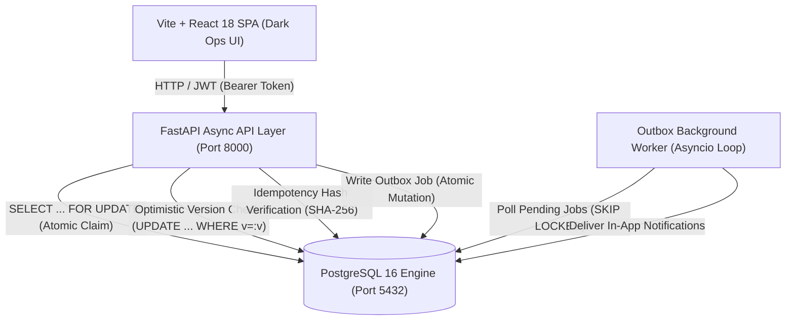

# Newtonite Ops – Operations Under Pressure

[](https://github.com/vyomeshh/newtonite-ops-23SCSE1011981)
[](LICENSE)
[](#)

> **Newtonite Software Engineering Challenge: "Operations Under Pressure"**  
> Candidate Admission / Roll No: `23SCSE1011981`

---

## 1. Executive Summary & Architecture Overview

**Newtonite Ops** is a high-concurrency, mission-critical operational command center engineered for organizations operating under extreme pressure. Unlike standard CRUD applications that fail under concurrent mutations and network retries, Newtonite Ops implements enterprise distributed systems patterns directly into the PostgreSQL storage engine and application layer.



> 📄 **Detailed Architectural Trade-offs:** See [ENGINEERING_DECISIONS.md](file:///p:/newtonite-ops-23SCSE1011981/ENGINEERING_DECISIONS.md) for full rationale on data modeling, dual-concurrency locking, idempotency guarantees, and outbox delivery.

---

## 2. The 7 Critical Behaviours Beyond CRUD

Newtonite Ops solves 7 hard engineering challenges that arise when scaling operational workflows:

### 1. Atomic Claim & Concurrent Race Condition Prevention
* **The Problem:** When an urgent incident arises, dozens of support engineers or automated workers attempt to claim it at the exact same millisecond. In standard CRUD, multiple workers overwrite the record and all believe they own it.
* **The Solution:** The `POST /api/items/{id}/claim` endpoint acquires a PostgreSQL row lock using `SELECT ... FOR UPDATE`. If the item is already claimed (`assignee_id IS NOT NULL`), the transaction detects this immediately and returns `HTTP 409 Conflict` with the current assignee details. Exactly one worker wins; all concurrent attempts are safely rejected.

### 2. Optimistic Concurrency Control (Version-Tracked Updates)
* **The Problem:** Two operators open incident #42 simultaneously. Operator A modifies the severity while Operator B modifies the description. Whichever saves last silently overwrites the other's changes ("lost update" anomaly).
* **The Solution:** Every `work_items` record carries a monotonic integer `version`. Every update request (`PUT /api/items/{id}`) must submit the current `version`. The update is executed atomically:
  ```sql
  UPDATE work_items 
  SET title = :title, version = version + 1 
  WHERE id = :id AND version = :expected_version;
  ```
  If zero rows were affected, the backend returns `HTTP 409 Conflict` alongside a `ConflictResponse` containing the server's latest state. The frontend presents a visual side-by-side reconciliation interface.

### 3. Idempotency Key Replay & Mutation Safety
* **The Problem:** Network drops or timeouts cause clients to retry `POST /api/items`. Without protection, duplicate charges, duplicate incidents, or duplicated tasks are created.
* **The Solution:** Clients provide a unique `Idempotency-Key` header. The backend computes a SHA-256 fingerprint of the request payload and checks the `idempotency_keys` table inside an atomic transaction:
  * **First Request:** Processes creation, stores response and hash, and returns `HTTP 201 Created`.
  * **Duplicate Request (Identical Payload):** Replays the cached response with `HTTP 200/201` and the response header `X-Idempotent-Replay: true`.
  * **Conflicting Request (Altered Payload):** Returns `HTTP 422 Unprocessable Entity` with a payload hash mismatch error.

### 4. Role-Governed Workflow State Machine
* **The Problem:** Invalid transitions (e.g., closing an unapproved compliance audit) lead to legal non-compliance.
* **The Solution:** Work items enforce strict state transitions:
  * `OPEN` → `IN_PROGRESS`
  * `IN_PROGRESS` → `AWAITING_APPROVAL` or `RESOLVED`
  * `AWAITING_APPROVAL` → `RESOLVED` (Approved) or `IN_PROGRESS` (Rejected)
  * `RESOLVED` → `CLOSED` or `OPEN` (Reopened)
  * `CLOSED` → `OPEN` (Reopened)
  * **LEAD-Only Sign-Off:** Only team members with role `LEAD` or `ADMIN` can approve items in `AWAITING_APPROVAL`. Unauthorized attempts are rejected with `HTTP 403 Forbidden`.

### 5. Multi-Tenant Team RBAC
* **The Problem:** Cross-team data leakage allows engineers to view or alter confidential investigations outside their department.
* **The Solution:** Hierarchical roles (`VIEWER` < `MEMBER` < `LEAD` < `ADMIN`) scoped strictly per team via the `memberships` table. Queries automatically filter to the teams the requesting user belongs to, preventing unauthorized access across Platform Engineering, Payments & Risk, Compliance & Legal, and Customer Operations.

### 6. Comprehensive Audit Trail & Activity Log
* **The Problem:** Critical incident post-mortems require an indisputable, tamper-evident log of who changed what and when.
* **The Solution:** Every creation, claim, transition, field update, and comment inserts an immutable record into `activity_events` recording `actor_id`, `event_type`, `old_value` (JSONB), `new_value` (JSONB), and timestamp.

### 7. Transactional Outbox Pattern & Background Worker
* **The Problem:** Dual-write failures occur when updating a database and publishing a message to a message broker. If the broker is unreachable, data becomes permanently desynchronized.
* **The Solution:** Workflow transitions write outbox jobs into `outbox_jobs` within the *same database transaction* as the status update. An asynchronous background loop polls pending jobs, handles retries with exponential backoff, prevents duplicate delivery via unique `dedupe_key`, and dispatches in-app notifications.

---

## 3. Technology Stack

| Layer | Technologies |
|---|---|
| **Backend** | Python 3.11+, FastAPI, SQLAlchemy 2.0 (asyncio + asyncpg), Pydantic v2, Python-Jose (JWT), Passlib (Bcrypt) |
| **Frontend** | React 18, TypeScript, Vite, TanStack Query v5, Tailwind CSS, Lucide React Icons |
| **Database** | PostgreSQL 16 Alpine with optimized composite indexes |
| **Containers** | Docker, Docker Compose, Multi-stage Nginx + Alpine builds |
| **Testing** | Pytest, Pytest-Asyncio, HTTPX |

---

## 4. Pre-Seeded Users & Teams

The database seeds automatically upon startup with **4 Teams**, **10 Users**, **2,500+ Work Items**, and **5,000+ Activity Events**.

All seeded users have the password: **`newtonite123`**

| Email | Full Name | Team Assignments & Roles |
|---|---|---|
| `admin@newtonite.io` | Alice Admin | **ADMIN** across all 4 teams |
| `lead.platform@newtonite.io` | Bob Lead | **LEAD** (Platform Engineering) |
| `lead.payments@newtonite.io` | Carol Lead | **LEAD** (Payments & Risk) |
| `lead.compliance@newtonite.io` | Diana Lead | **LEAD** (Compliance & Legal) |
| `member.platform@newtonite.io` | Eve Member | **MEMBER** (Platform Engineering) |
| `member.payments@newtonite.io` | Frank Member | **MEMBER** (Payments & Risk) |
| `member.compliance@newtonite.io` | Grace Member | **MEMBER** (Compliance & Legal) |
| `member.custops@newtonite.io` | Hank Member | **MEMBER** (Customer Operations) |
| `viewer.platform@newtonite.io` | Ivy Viewer | **VIEWER** (Platform Engineering) |
| `external@newtonite.io` | Jack External | **VIEWER** (Customer Operations) |

---

## 5. Quick Start (Running via Docker Compose)

### Prerequisites
* Docker Engine 20.10+
* Docker Compose v2+

### One-Command Launch
```bash
docker compose up --build
```

### Endpoints
* **Frontend Application:** `http://localhost:3000`
* **Backend API & Swagger Docs:** `http://localhost:8000/docs`
* **Health Check:** `http://localhost:8000/api/health`
* **PostgreSQL Database:** `localhost:5432` (User: `newtonite`, Pass: `newtonite_secret_2024`, DB: `newtonite_ops`)

---

## 6. Running the Automated Test Suite

Newtonite Ops includes comprehensive automated test coverage verifying concurrency, row locking, idempotency replay, workflow transitions, team isolation, and the outbox pattern.

### Run Tests Inside the Backend Container:
```bash
docker compose exec backend pytest -v
```

### Run Tests Locally (with PostgreSQL running):
```bash
cd backend
python -m venv .venv
source .venv/bin/activate  # or .venv\Scripts\activate on Windows
pip install -r requirements.txt
pytest -v
```

### Verified Test Cases:
1. `test_concurrent_claim_race_condition`: Fires 5 simultaneous HTTP claim requests; exactly 1 receives HTTP 200, 4 receive HTTP 409.
2. `test_optimistic_locking_stale_update`: Rejects stale updates with HTTP 409 and returns the current server version.
3. `test_idempotency_key_replay`: Replays identical payload with header `X-Idempotent-Replay: true`.
4. `test_idempotency_payload_mismatch`: Rejects tampered payloads with HTTP 422.
5. `test_workflow_transition_regular`: Transitions items through the state machine.
6. `test_workflow_approval_lead_only`: Enforces LEAD/ADMIN role checks for approving items in `AWAITING_APPROVAL`.
7. `test_team_rbac_resource_isolation`: Verifies team members cannot view or modify items from other teams.
8. `test_activity_log_immutability`: Asserts activity log records every field change and comment.
9. `test_transactional_outbox_processing`: Verifies background outbox poller delivers notifications and updates outbox status to `COMPLETED`.

---

## 7. Interactive Stress Test Lab

The application includes an in-app **Operational Pressure Test Lab** accessible via the top navigation bar:

1. **Race Condition Simulator:** Choose an unassigned item (or generate one) and set concurrency from 2 to 10 parallel threads. Fire the simulation to watch row locks reject all but one claimant in real-time.
2. **Idempotency Replay Tester:** Submit Step 1 (Initial POST), Step 2 (Duplicate with identical payload), and Step 3 (Duplicate with modified payload) to witness replay headers and 422 rejection.
3. **Outbox Health Monitor:** Real-time counter of pending, processing, and completed outbox notification jobs processed every 5 seconds.

---

## 8. Known Limitations

1. **Single-Node Database Topology:** The application currently runs against a primary PostgreSQL instance. Under extreme write throughput (tens of thousands of simultaneous mutations/sec), read replicas and connection poolers (PgBouncer) would be required.
2. **In-Process Asyncio Worker:** The outbox processor runs as an `asyncio` task within the FastAPI lifespan. For horizontal multi-instance backend deployments, jobs should either use `SKIP LOCKED` across workers (which the query supports) or migrate to a distributed orchestrator like Celery or Temporal.
3. **Stateless JWT Invalidation:** JWT access tokens expire after 8 hours; immediate revocation prior to expiration requires introducing a distributed token revocation store (e.g. Redis blocklist).
4. **Client-Side Polling instead of WebSockets:** The dashboard polls for summary and notification updates every 5–10s. While lightweight and robust against dropped connections, sub-second operational collaboration would benefit from Server-Sent Events (SSE).

---

## 9. Next Week I Would... (Future Roadmap)

- [ ] **Read-Replica Routing:** Separate read-only dashboard summary and search queries to hot standby replicas using SQLAlchemy engine routing.
- [ ] **Table Partitioning:** Partition `activity_events` and `outbox_jobs` tables by calendar month (`RANGE (created_at)`) to maintain constant query performance as event logs scale past millions of rows.
- [ ] **Full-Text & Semantic Search:** Integrate PostgreSQL `pg_trgm` and `tsvector` with GIN indexing for sub-millisecond fuzzy search across operational descriptions and comments.
- [ ] **Live Collaboration via Server-Sent Events (SSE):** Push instant ticket claim and approval events directly to connected operators without polling overhead.
- [ ] **Automated SLA Escalation Engine:** Background worker that automatically escalates priority to `URGENT` when items approach SLA breach thresholds (`due_date - now() < 1 hour`).

---

## 10. License

Developed for the Newtonite Software Engineering Challenge. MIT License.
